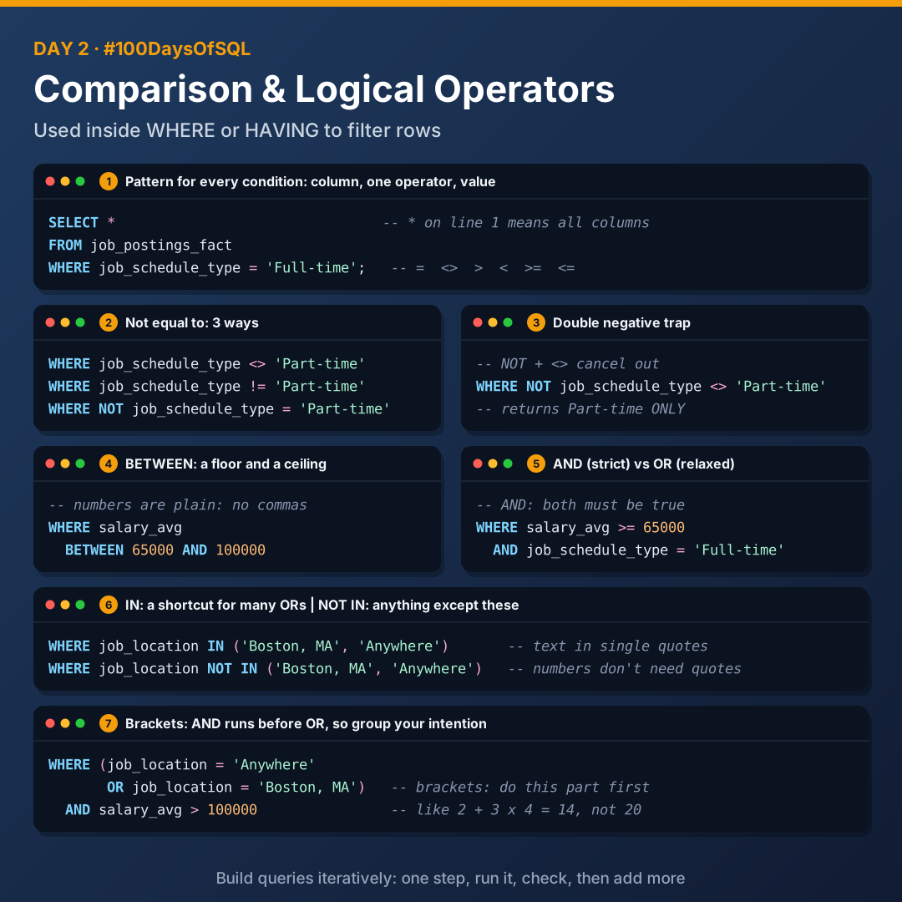
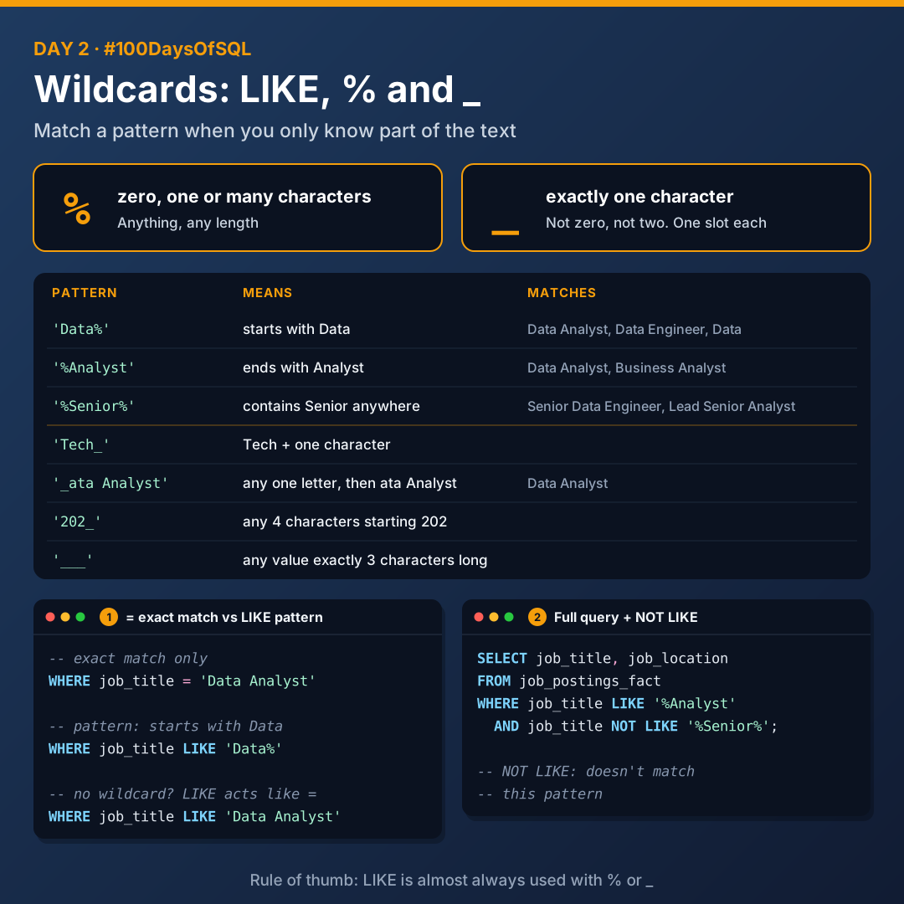

# Day 2: Filtering with Operators and Wildcards

Today I learnt how to filter data in the `WHERE` clause using comparison operators, logical operators and wildcards.



## Comparison and logical operators

They are used within the `WHERE` or `HAVING` clause.

| Type | Operators |
|------|-----------|
| Comparison | `=`, `<>`, `>`, `<`, `>=`, `<=` |
| Logical | `AND`, `OR`, `BETWEEN`, `IN` |

**Pattern for every condition:** column, one operator, value. SQL expects exactly one comparison operator between the column and the value.

```sql
SELECT *
FROM job_postings_fact
WHERE job_schedule_type = 'Full-time';
```

- `SELECT *` on line 1 means all columns.
- Commas go between columns, never after the last one.

### Not equal to

There are three ways to write it:

```sql
WHERE job_schedule_type <> 'Part-time'
WHERE job_schedule_type != 'Part-time'
WHERE NOT job_schedule_type = 'Part-time'
```

> **Double negative trap:** using `NOT` together with `<>` (or `!=`) creates a double negative. The two cancel out and return the very value you were trying to exclude.
>
> ```sql
> WHERE NOT job_schedule_type <> 'Part-time'   -- returns Part-time ONLY
> ```
>
> Use `NOT` with `=` instead.

### BETWEEN

`BETWEEN` is for a range with two limits, written with `AND`.

```sql
WHERE salary_avg BETWEEN 65000 AND 100000
```

- If the question gives you **one number**, use a comparison operator.
- If it gives you **two** (a floor and a ceiling), `BETWEEN` is an option.
- Numbers in SQL are written plain: `65000`, without commas.

### AND vs OR

| Operator | Meaning | Feel |
|----------|---------|------|
| `AND` | Both conditions must be true | Strict |
| `OR` | At least one condition must be true | Relaxed |

### IN and NOT IN

`IN` is a shortcut for many `OR`s. It matches any item in the list.

```sql
WHERE job_location IN ('Boston, MA', 'Anywhere')
```

**Rules for IN:**

1. Put the list inside brackets `()`
2. Separate items with commas
3. Text items go in single quotes; numbers don't
4. Use it when you're checking one column against several values

You can also flip it. `NOT IN` matches anything except the list:

```sql
WHERE job_location NOT IN ('Boston, MA', 'Anywhere')
```

### Brackets and the order of operations

SQL has a built-in rule: **`AND` is handled before `OR`**, just like maths does multiplication before addition (`2 + 3 x 4 = 14`, not 20).

Brackets `()` mean "do this part first", and each bracket is a self-contained rule.

```sql
WHERE (job_location = 'Anywhere'
       OR job_location = 'Boston, MA')
  AND salary_avg > 100000
```

Whenever a `WHERE` has both `AND` and `OR`, use brackets to group things. Even when they're not strictly needed, they make your intention clear.

## Wildcards



1. Wildcards are used to substitute one or more characters in a string
2. Wildcards are used with the `LIKE` operator
3. `LIKE`, `%` and `_` are all used in the `WHERE` clause

### = vs LIKE

| Operator | Checks for | Example |
|----------|------------|---------|
| `=` | An exact match | `name = 'Tech'` |
| `LIKE` | A pattern, when you only know part of the text | `name LIKE 'Tech%'` |
| `NOT LIKE` | Doesn't match the pattern | `name NOT LIKE 'Tech%'` |

`LIKE` is almost always used with the wildcards `%` and `_`. Without them, it behaves just like `=`.

### % : anything, any length

Stands for zero, one or many characters. Where you put it changes the meaning:

| Pattern | Meaning | Matches |
|---------|---------|---------|
| `'Data%'` | Starts with Data | Data Analyst, Data Engineer, Data |
| `'%Analyst'` | Ends with Analyst | Data Analyst, Business Analyst |
| `'%Senior%'` | Contains Senior anywhere | Senior Data Engineer, Lead Senior Analyst |

### _ : exactly one character

Stands for exactly one character: not zero, not two. Each `_` is one slot, so use several for several characters.

| Pattern | Meaning |
|---------|---------|
| `'Tech_'` | Tech plus one character |
| `'_ata Analyst'` | Any one letter, then "ata Analyst" |
| `'202_'` | Any 4-character string starting with 202 |
| `'___'` | Any value exactly 3 characters long |

## Iteration

**Iteration** means building a query one step at a time: write it in small steps, run it after each step, and check the results before adding more.

## Files

| File | What it covers |
|------|----------------|
| [`01_comparison_logical_operators.sql`](./01_comparison_logical_operators.sql) | Not equal to, double negative, BETWEEN, AND/OR, IN/NOT IN, brackets |
| [`02_wildcards.sql`](./02_wildcards.sql) | LIKE, NOT LIKE, `%` and `_` |

## Key takeaways

- Every condition follows the same pattern: column, one operator, value.
- Avoid `NOT` with `<>`: the double negative flips your result.
- `AND` runs before `OR`, so use brackets whenever you mix them.
- `%` is any length; `_` is exactly one character.

---

[Back to all days](../README.md)
