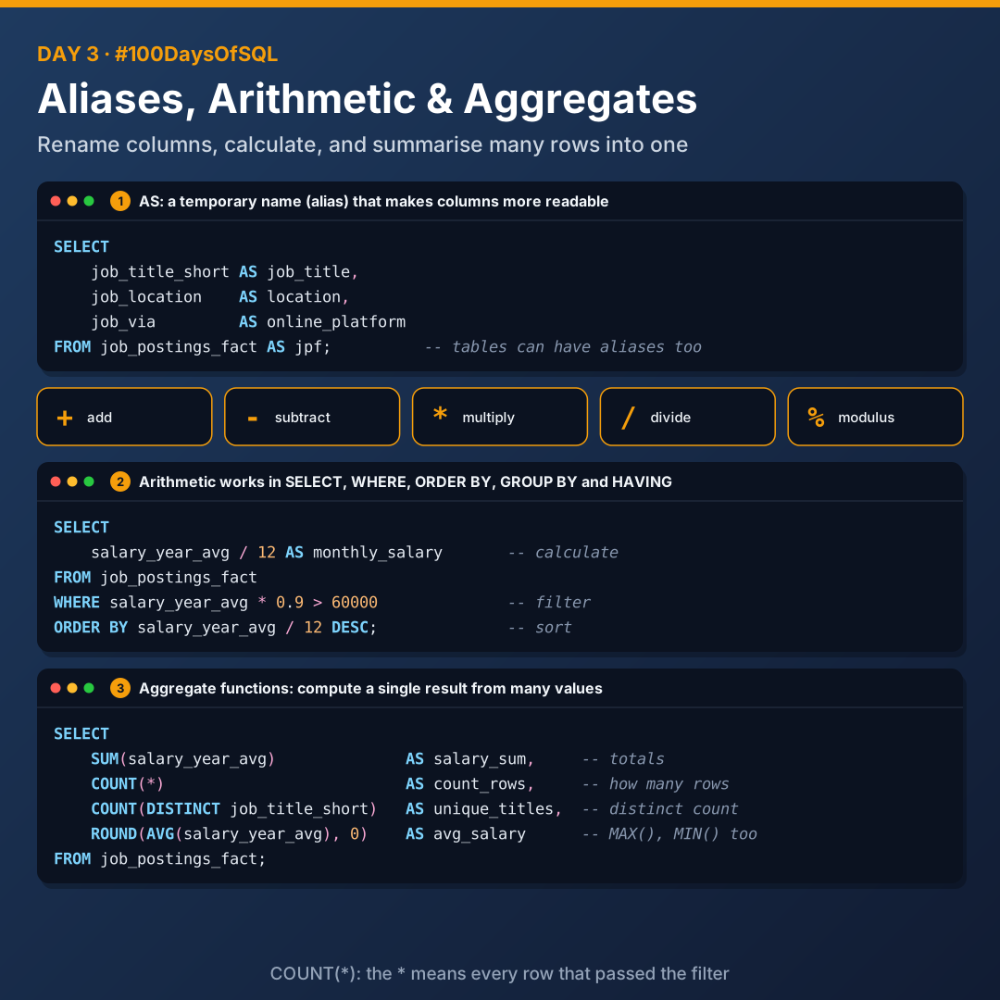
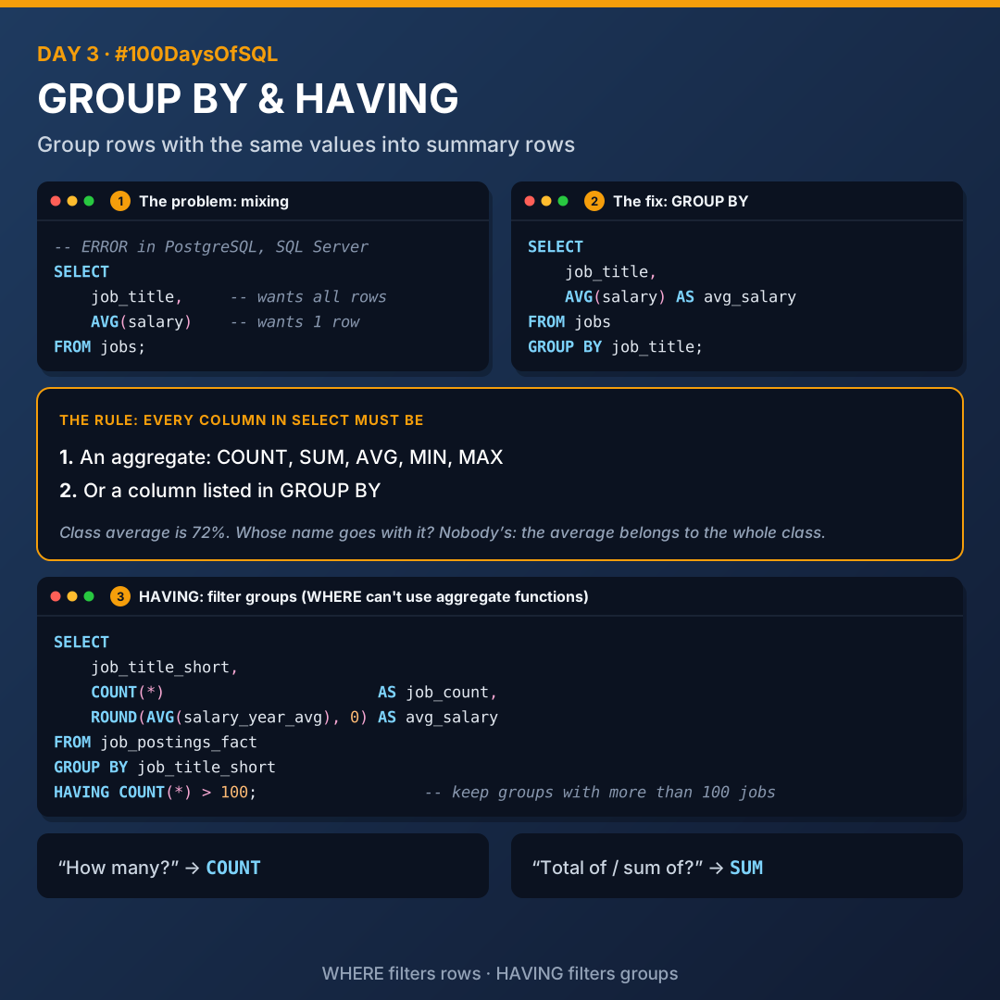

# Day 3: Aliases, Arithmetic, Aggregates and GROUP BY

Today I learnt how to rename columns, do maths inside a query, summarise many rows into one, and group results.



## Aliases with AS

`AS` renames a column in a table with a temporary name, called an **alias**. It makes column names more readable.

```sql
SELECT
    job_title_short AS job_title,
    job_location    AS location,
    job_via         AS online_platform
FROM job_postings_fact AS jpf;
```

Tables can have aliases too (`jpf` above).

## Arithmetic operations

| Operator | Operation |
|----------|-----------|
| `+` | Addition |
| `-` | Subtraction |
| `*` | Multiplication |
| `/` | Division |
| `%` | Modulus (returns the remainder of a division) |

Arithmetic operations can be used in these clauses:

1. **SELECT**: performing calculations on data retrieved from the database
2. **WHERE**: filtering data based on conditions that involve arithmetic or logical operations
3. **ORDER BY**: sorting results based on expressions that involve operations
4. **GROUP BY and HAVING**: grouping rows that have the same values, and filtering groups with conditions that involve operations

```sql
SELECT
    salary_year_avg / 12 AS monthly_salary
FROM job_postings_fact
WHERE salary_year_avg * 0.9 > 60000
ORDER BY salary_year_avg / 12 DESC;
```

## Aggregate functions

Aggregate functions compute a single result from many input values. They are used together with `SELECT`, `GROUP BY` and `HAVING`.

| Function | What it does |
|----------|--------------|
| `SUM()` | Adds up the values in a column. Use it for totals |
| `COUNT()` | Counts the number of rows |
| `AVG()` | Average value |
| `MAX()` | Maximum value |
| `MIN()` | Minimum value |
| `ROUND()` | Rounds a number off |

```sql
SELECT
    SUM(salary_year_avg) AS salary_sum,
    COUNT(*)             AS count_rows
FROM job_postings_fact;
```

- `COUNT(*)` counts rows. The `*` means "every row that passed the filter". Use it for "how many".
- `COUNT(DISTINCT column)` gives the distinct count of rows that match the criteria.

> **Tip:** if the question says "how many" or "count", reach for `COUNT`. If it says "total of" or "sum of", reach for `SUM`.

## GROUP BY



`GROUP BY` groups rows that have the same values into summary rows, for example "total number of sales by each item".

### The problem: mixing plain columns with aggregates

A **plain column** is just a column selected as-is, with no function around it.

```sql
-- ERROR in PostgreSQL, SQL Server and most databases
SELECT
    job_title,
    AVG(salary)
FROM jobs;
```

- `AVG(salary)` wants to return **1 row**.
- `job_title` wants to return **all rows** with job titles.

That can only return one row, which doesn't make sense, because job title has many rows, not just one.

> **Analogy:** a teacher says the class average is 72%, and you ask whose name goes with that. The question doesn't make sense, because the average belongs to the whole class.

### The fix

```sql
SELECT
    job_title,
    AVG(salary) AS avg_salary
FROM jobs
GROUP BY job_title;
```

### The rule

Every column in your `SELECT` must be either:

1. An aggregate (`COUNT`, `SUM`, `AVG`, `MIN`, `MAX`), **or**
2. A column listed in `GROUP BY`

If you have an aggregate function, you need to include every column that's not aggregated in `GROUP BY`, or you get an error.

## HAVING

`HAVING` filters a query based on aggregate functions and groupings. It's needed because you can't use aggregate functions in `WHERE`.

```sql
SELECT
    job_title_short,
    COUNT(*)                       AS job_count,
    ROUND(AVG(salary_year_avg), 0) AS avg_salary
FROM job_postings_fact
GROUP BY job_title_short
HAVING COUNT(*) > 100;
```

| Clause | Filters |
|--------|---------|
| `WHERE` | Rows |
| `HAVING` | Groups |

## Files

| File | What it covers |
|------|----------------|
| [`01_aliases.sql`](./01_aliases.sql) | Column and table aliases, plus a practice problem |
| [`02_arithmetic_operations.sql`](./02_arithmetic_operations.sql) | `+ - * / %` in SELECT, WHERE and ORDER BY |
| [`03_aggregate_functions.sql`](./03_aggregate_functions.sql) | SUM, COUNT, COUNT(DISTINCT), AVG, MAX, MIN, ROUND |
| [`04_group_by_having.sql`](./04_group_by_having.sql) | The mixing problem, GROUP BY and HAVING |

## Key takeaways

- Aliases make results readable without changing the table.
- Aggregate functions turn many rows into one result.
- Every column in SELECT is either aggregated or listed in GROUP BY.
- WHERE filters rows; HAVING filters groups.

---

[Back to all days](../README.md)
