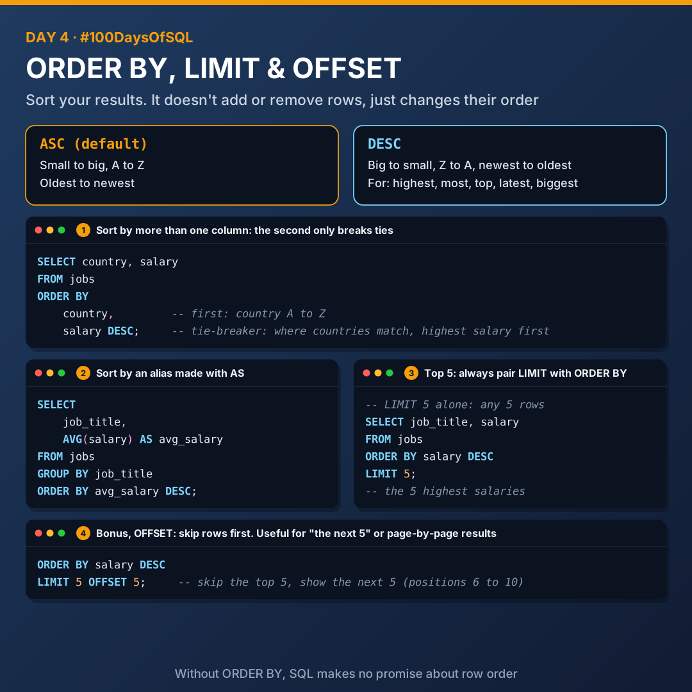
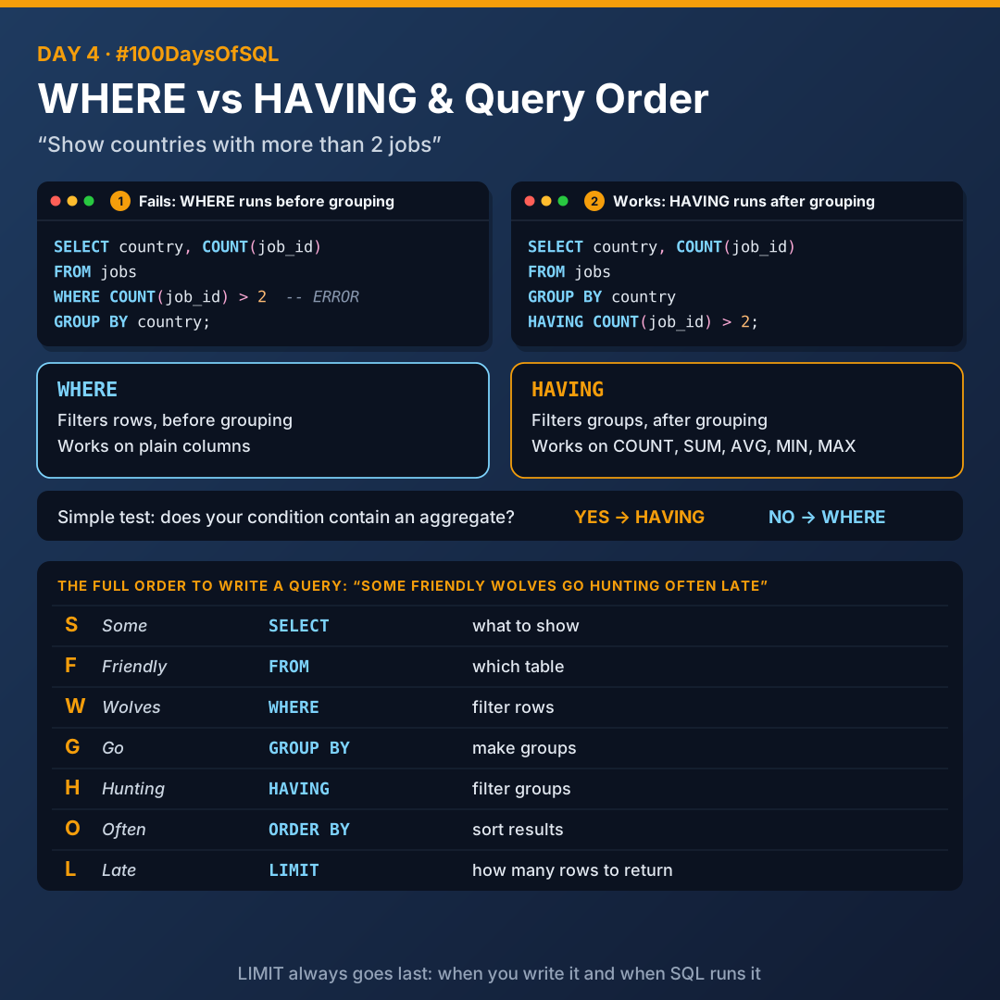

# Day 4: ORDER BY, LIMIT, OFFSET and WHERE vs HAVING

Today I learnt how to sort and trim results, why WHERE can't do HAVING's job, and the full order to write a query.



## ORDER BY

`ORDER BY` sorts your results. That's all. It doesn't add or remove rows, it just changes their order.

| Keyword | Direction | Examples |
|---------|-----------|----------|
| `ASC` | Ascending (the default) | Small to big, A to Z, oldest to newest |
| `DESC` | Descending | Big to small, Z to A, newest to oldest |

```sql
ORDER BY salary DESC
```

> **When to use DESC:** any question with **highest**, **most**, **top**, **latest** or **biggest**.

### Sorting by more than one column

```sql
ORDER BY
    country,
    salary DESC
```

This means: sort by country first (A to Z). Where countries are the same, sort those rows by salary, highest first. The second column only acts as a **tie-breaker** inside the first.

### Sorting by an alias

You can sort by a name you created with `AS`:

```sql
SELECT
    job_title,
    AVG(salary) AS avg_salary
FROM jobs
GROUP BY job_title
ORDER BY avg_salary DESC;
```

### ORDER BY tips

1. It always goes near the end of the query.
2. Without `ORDER BY`, SQL makes no promise about row order. If order matters, say so.
3. In SQLite, `NULL`s come first with `ASC` and last with `DESC`. Other databases can differ.

## LIMIT

`LIMIT` cuts your results down to a set number of rows. It always goes last, both when you write it and when SQL runs it.

**When to use it:**

- "Top", "highest 10", "first": `ORDER BY ... DESC` plus `LIMIT`
- Previewing a big table without loading thousands of rows
- Speed: smaller results load faster while you're testing

### Pair it with ORDER BY

`LIMIT` on its own just takes whichever rows come first, which could be anything. To get a meaningful "top 5", sort first.

| Query | Result |
|-------|--------|
| `LIMIT 5` | Any 5 rows |
| `ORDER BY salary DESC LIMIT 5` | The 5 highest salaries |

### Bonus: OFFSET

`OFFSET` skips rows before starting. It's useful for "the next 5" or page-by-page results.

```sql
ORDER BY salary DESC
LIMIT 5 OFFSET 5;
```

That means: skip the top 5, then show the next 5 (positions 6 to 10).

## WHERE vs HAVING



The question: *"Show countries with more than 2 jobs."*

```sql
-- This fails
SELECT country, COUNT(job_id)
FROM jobs
WHERE COUNT(job_id) > 2
GROUP BY country;
```

It fails because of the order SQL works in.

| Clause | Filters | When | Works on |
|--------|---------|------|----------|
| `WHERE` | Rows | Before grouping | Plain columns |
| `HAVING` | Groups | After grouping | Aggregates (`COUNT`, `SUM`, `AVG`, `MIN`, `MAX`) |

```sql
-- This works
SELECT country, COUNT(job_id) AS job_count
FROM jobs
GROUP BY country
HAVING COUNT(job_id) > 2;
```

> **Simple test:** does your condition contain an aggregate function? **Yes** → `HAVING`. **No** → `WHERE`.

## The full order to write a query

Mnemonic: **S**ome **F**riendly **W**olves **G**o **H**unting **O**ften **L**ate

| Clause | Job |
|--------|-----|
| `SELECT` | What to show |
| `FROM` | Which table |
| `WHERE` | Filter rows |
| `GROUP BY` | Make groups |
| `HAVING` | Filter groups |
| `ORDER BY` | Sort results |
| `LIMIT` | How many rows to return |

## Quick reference

| Syntax | Meaning |
|--------|---------|
| `ORDER BY column` | Sort small to big (`ASC` is the default) |
| `ORDER BY column DESC` | Sort big to small |
| `ORDER BY a, b` | Sort by a, then by b to break ties |
| `HAVING` | Filter groups using aggregates |
| `WHERE` | Filter rows, no aggregates allowed |
| `HAVING` | Needs `GROUP BY` (in normal use) |
| `LIMIT` | Cuts results down to a set number of rows |

## Files

| File | What it covers |
|------|----------------|
| [`01_order_by.sql`](./01_order_by.sql) | ASC, DESC, multi-column sorting, sorting by an alias |
| [`02_limit_offset.sql`](./02_limit_offset.sql) | LIMIT, pairing with ORDER BY, OFFSET |
| [`03_where_vs_having.sql`](./03_where_vs_having.sql) | Why WHERE fails with aggregates, and the HAVING fix |
| [`04_full_query_order.sql`](./04_full_query_order.sql) | All seven clauses in one query |

## Key takeaways

- `ORDER BY` changes order, never the number of rows.
- A "top 5" needs `ORDER BY` before `LIMIT`.
- Aggregate in the condition? Use `HAVING`. Otherwise, `WHERE`.
- Some Friendly Wolves Go Hunting Often Late.

---

[Back to all days](../README.md)
