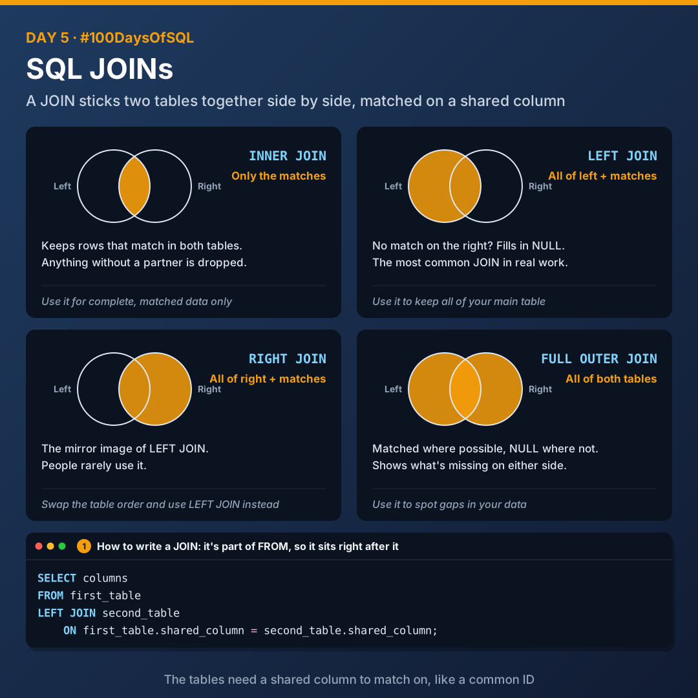
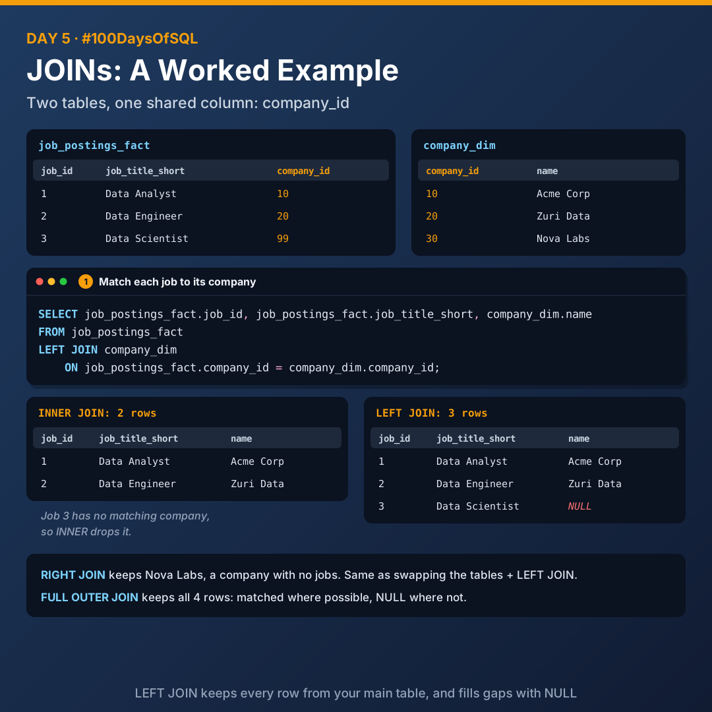

# Day 5: SQL JOINs

Today I learnt how to combine tables with JOINs: INNER, LEFT, RIGHT and FULL OUTER.



## Why JOINs?

Your data is often split across different tables, for example 4 separate spreadsheets. A **JOIN** sticks two tables together side by side, so you can see information from both in one result.

For that to work, the tables need a **shared column** to match on, like a common ID.

## The four JOINs

### INNER JOIN: only the matches

Keeps rows that match in both tables. Anything without a partner is dropped.

> Use it when you only want complete, matched data.

### LEFT JOIN: all of left + matches

Keeps every row from the first (left) table. If there's no match on the right, it fills in `NULL`.

> Use it when you want all of your main table, even if some details are missing. This is the **most common JOIN in real work**.

### RIGHT JOIN: all of right + matches

The mirror image: keeps every row from the right table.

> People rarely use RIGHT JOIN. You can get the same result by swapping the table order and using LEFT JOIN.

### FULL OUTER JOIN: all of both tables

Keeps all rows from both tables, matched where possible, `NULL` where not.

> Use it when you want to see everything, including what's missing on either side. Great for spotting gaps in data.

## Summary

| JOIN | Keeps |
|------|-------|
| `INNER JOIN` | Only matches |
| `LEFT JOIN` | All of left + matches |
| `RIGHT JOIN` | All of right + matches |
| `FULL OUTER JOIN` | All of both tables |

Picture two overlapping circles: **INNER** is the overlap, **LEFT** is the whole left circle, **RIGHT** is the whole right circle, and **FULL** is both circles.

## How to write a JOIN

`JOIN` is part of `FROM`, so it sits right after it.

```sql
SELECT columns
FROM first_table
LEFT JOIN second_table
    ON first_table.shared_column = second_table.shared_column;
```

## Worked example



Two sample tables that share `company_id`:

**job_postings_fact**

| job_id | job_title_short | company_id |
|--------|-----------------|------------|
| 1 | Data Analyst | 10 |
| 2 | Data Engineer | 20 |
| 3 | Data Scientist | 99 |

**company_dim**

| company_id | name |
|------------|------|
| 10 | Acme Corp |
| 20 | Zuri Data |
| 30 | Nova Labs |

Job 3 has no matching company, and Nova Labs has no jobs. Each JOIN treats those differently:

| JOIN | Rows | What happens to the unmatched rows |
|------|------|------------------------------------|
| `INNER JOIN` | 2 | Both dropped |
| `LEFT JOIN` | 3 | Job 3 kept, company name is `NULL` |
| `RIGHT JOIN` | 3 | Nova Labs kept, job columns are `NULL` |
| `FULL OUTER JOIN` | 4 | Both kept, with `NULL`s |

## Files

| File | What it covers |
|------|----------------|
| [`00_sample_tables.sql`](./00_sample_tables.sql) | Creates the two sample tables (run this first) |
| [`01_inner_join.sql`](./01_inner_join.sql) | INNER JOIN |
| [`02_left_join.sql`](./02_left_join.sql) | LEFT JOIN |
| [`03_right_join.sql`](./03_right_join.sql) | RIGHT JOIN, and the same result with LEFT JOIN |
| [`04_full_outer_join.sql`](./04_full_outer_join.sql) | FULL OUTER JOIN |

## Key takeaways

- JOINs need a shared column to match on.
- INNER drops anything without a partner. LEFT keeps your whole main table.
- LEFT JOIN is the one you'll use most.
- `NULL` in a JOIN result means "no match found".

---

[Back to all days](../README.md)
