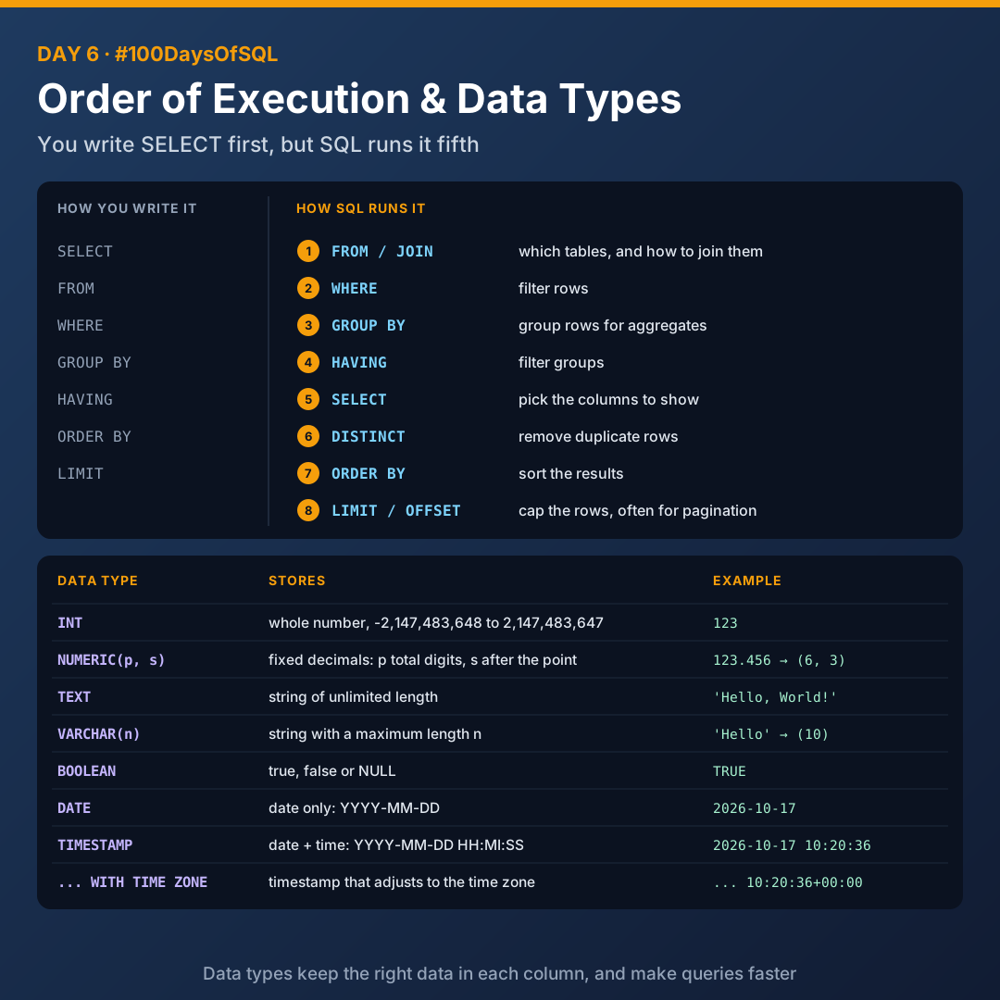
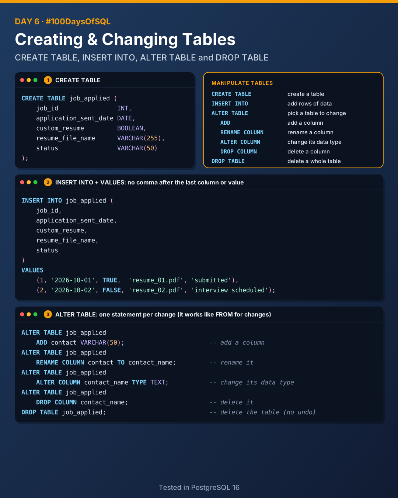

# Day 6: Order of Execution, Data Types and Managing Tables

Today I learnt the order SQL actually runs a query in, then moved into the advanced section: setting up PostgreSQL, data types, and creating and changing tables.



## Order of execution

The order you **write** a query is not the order SQL **runs** it.

| Step | Clause | What it does |
|------|--------|--------------|
| 1 | `FROM` / `JOIN` | Specifies the tables to retrieve data from, and how to join them |
| 2 | `WHERE` | Filters rows based on conditions |
| 3 | `GROUP BY` | Groups rows that share a property so aggregate functions can be applied |
| 4 | `HAVING` | Filters groups based on aggregate conditions, after `GROUP BY` |
| 5 | `SELECT` | Selects the specific columns to display in the final result |
| 6 | `DISTINCT` | Removes duplicate rows from the result set |
| 7 | `ORDER BY` | Sorts the result set by the specified columns or values |
| 8 | `LIMIT` / `OFFSET` | Limits the number of rows returned, often used for pagination |

```sql
SELECT                              -- 5
    job_title_short,
    COUNT(*) AS job_count
FROM                                -- 1
    job_postings_fact
WHERE                               -- 2
    salary_year_avg > 50000
GROUP BY                            -- 3
    job_title_short
HAVING                              -- 4
    COUNT(*) > 100
ORDER BY                            -- 7
    job_count DESC
LIMIT                               -- 8
    5;
```

## PostgreSQL setup

```sql
CREATE DATABASE sql_course;
```

Then run the query with **Ctrl+E, Ctrl+E**.

## Data types

Data types specify the expected format of a value.

**Why?** They're needed for **data integrity**: they make sure only the correct data is stored in a column. They also help databases process data more quickly and store it with less space.

| Data type | What it stores | Example |
|-----------|----------------|---------|
| `INT` | A whole number. Range -2,147,483,648 to 2,147,483,647 (4 bytes) | `123` |
| `NUMERIC(precision, scale)` | A precise number with fixed decimal points. Precision is the total number of digits, scale is the digits after the decimal point | `123.456` is `NUMERIC(6, 3)` |
| `TEXT` | A string of unlimited length. Used for long-form text that doesn't fit `VARCHAR`'s size limit | `'Hello, World!'` |
| `VARCHAR(n)` | A variable-length string, where `n` is the maximum length | `'Hello'` with `VARCHAR(10)` |
| `BOOLEAN` | True, false or `NULL` | `TRUE` |
| `DATE` | A date without time, in `YYYY-MM-DD` format | `2026-10-17` |
| `TIMESTAMP` | A date and time without a time zone, `YYYY-MM-DD HH:MI:SS` | `2026-10-17 10:20:36` |
| `TIMESTAMP WITH TIME ZONE` | A date and time with time zone information. Adjusts the stored time based on the time zone | `2026-10-17 10:20:36+00:00` |

## Manipulating tables



| Command | What it does |
|---------|--------------|
| `CREATE TABLE` | Creates a table |
| `INSERT INTO` | Adds rows of data to a table |
| `ALTER TABLE` | Selects the table to change |
| `ADD` | Adds a column |
| `RENAME COLUMN` | Renames a column |
| `ALTER COLUMN` | Changes the data type of a column |
| `DROP COLUMN` | Deletes a column |
| `DROP TABLE` | Deletes a whole table |

### CREATE TABLE

```sql
CREATE TABLE job_applied (
    job_id                INT,
    application_sent_date DATE,
    custom_resume         BOOLEAN,
    resume_file_name      VARCHAR(255),
    status                VARCHAR(50)
);
```

### INSERT INTO

`INSERT INTO` names the table and columns. `VALUES` specifies the data you want to add.

```sql
INSERT INTO job_applied (
    job_id,
    application_sent_date,
    custom_resume,
    resume_file_name,
    status
)
VALUES
    (1, '2026-10-01', TRUE,  'resume_01.pdf', 'submitted'),
    (2, '2026-10-02', FALSE, 'resume_02.pdf', 'interview scheduled');
```

> **Watch out:** no comma after the last column or the last value. A trailing comma gives a syntax error.

### ALTER TABLE

`ALTER TABLE` selects the table you'll add, delete or modify columns in. It's similar to using `FROM` to specify a table for querying. Each change is its own statement:

```sql
ALTER TABLE job_applied
    ADD contact VARCHAR(50);

ALTER TABLE job_applied
    RENAME COLUMN contact TO contact_name;

ALTER TABLE job_applied
    ALTER COLUMN contact_name TYPE TEXT;

ALTER TABLE job_applied
    DROP COLUMN contact_name;
```

### DROP TABLE

```sql
DROP TABLE job_applied;
```

> There's no undo, so be careful.

## Files

All files were tested in PostgreSQL 16.

| File | What it covers |
|------|----------------|
| [`01_order_of_execution.sql`](./01_order_of_execution.sql) | The 8 steps, numbered inside a real query |
| [`02_data_types.sql`](./02_data_types.sql) | Every data type from today in one SELECT |
| [`03_create_insert.sql`](./03_create_insert.sql) | CREATE TABLE and INSERT INTO |
| [`04_alter_drop.sql`](./04_alter_drop.sql) | ADD, RENAME COLUMN, ALTER COLUMN, DROP COLUMN, DROP TABLE |

## Key takeaways

- SQL runs `FROM` first and `SELECT` fifth, not in the order you write it.
- Picking the right data type protects your data and saves space.
- `NUMERIC(6, 3)` means 6 digits in total, 3 after the decimal point.
- One `ALTER TABLE` statement per change, and no trailing commas.

---

[Back to all days](../README.md)
