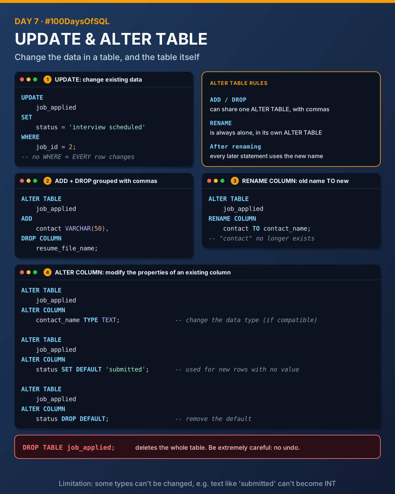
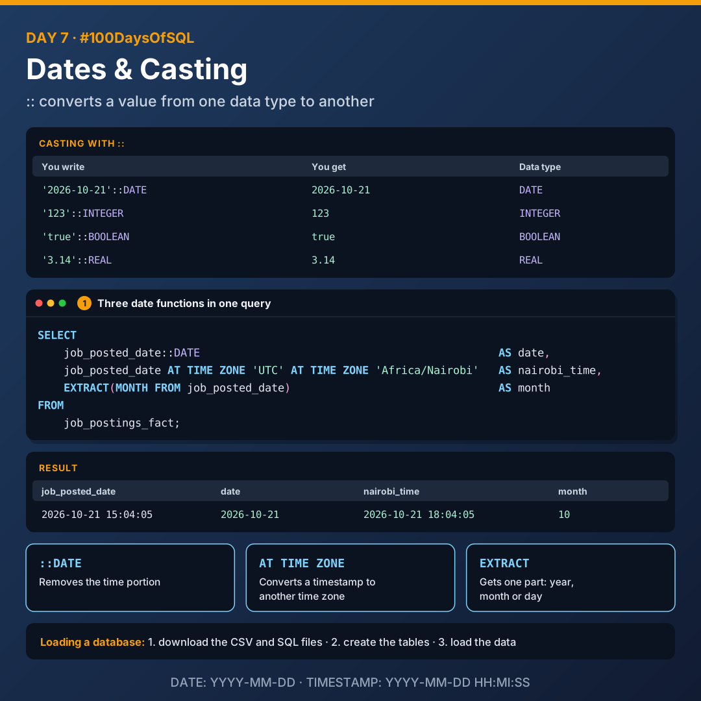

# Day 7: UPDATE, ALTER TABLE and Dates

Today I learnt how to change data that's already in a table, how to change the table itself in more depth, and how to work with dates in PostgreSQL.



## UPDATE

| Keyword | What it does |
|---------|--------------|
| `UPDATE` | Modifies existing data in a table |
| `SET` | Specifies the column to update and its new value |
| `WHERE` | Filters which rows to update, based on a condition |

```sql
UPDATE
    job_applied
SET
    status = 'interview scheduled'
WHERE
    job_id = 2;
```

> Without `WHERE`, `UPDATE` changes **every** row in the table.

## RENAME COLUMN

Renames a column in an existing table. It needs the old column name and the new column name.

```sql
ALTER TABLE
    job_applied
RENAME COLUMN
    contact TO contact_name;
```

**Rules:**

- `ADD` and `DROP` can be grouped with commas in one `ALTER TABLE`.
- `RENAME` is always alone, in its own `ALTER TABLE`.
- After renaming, every later statement must use the new name.

```sql
ALTER TABLE
    job_applied
ADD
    contact VARCHAR(50),
DROP COLUMN
    resume_file_name;
```

## ALTER COLUMN

`ALTER COLUMN` modifies the properties of an existing column.

**Change the data type**, subject to compatibility between the old and new types:

```sql
ALTER TABLE
    job_applied
ALTER COLUMN
    contact_name TYPE TEXT;
```

> **Limitation:** certain data types can't be changed. For example, a text column holding values like `'submitted'` can't become `INT`. PostgreSQL returns: *column "status" cannot be cast automatically to type integer*.

**Set or change a default value.** The default is used for new rows when no value is specified:

```sql
ALTER TABLE
    job_applied
ALTER COLUMN
    status SET DEFAULT 'submitted';
```

**Drop the default value**, removing it from the column if one exists:

```sql
ALTER TABLE
    job_applied
ALTER COLUMN
    status DROP DEFAULT;
```

## DROP TABLE

Deletes an existing table. Be extremely careful when you do this: there's no undo.

```sql
DROP TABLE
    job_applied;
```

## Loading a database

1. Download the CSV and SQL files
2. Create the tables in the database
3. Load the data into the tables

## Dates and casting



### Casting with ::

`::` is used for **casting**: converting a value from one data type to another. You can use it to convert lots of different data types:

```sql
SELECT
    '2026-10-21'::DATE,
    '123'::INTEGER,
    'true'::BOOLEAN,
    '3.14'::REAL;
```

### Date functions

Date functions perform operations on date and time values.

| Function | What it does |
|----------|--------------|
| `::DATE` | Converts to a date format by removing the time portion |
| `AT TIME ZONE` | Converts a timestamp to a specified time zone. Works on timestamps with or without time zone information |
| `EXTRACT` | Gets specific date parts, e.g. year, month, day |

```sql
SELECT
    job_posted_date::DATE                                              AS date,
    job_posted_date AT TIME ZONE 'UTC' AT TIME ZONE 'Africa/Nairobi'   AS nairobi_time,
    EXTRACT(MONTH FROM job_posted_date)                                AS month
FROM
    job_postings_fact;
```

| job_posted_date | date | nairobi_time | month |
|-----------------|------|--------------|-------|
| 2026-10-21 15:04:05 | 2026-10-21 | 2026-10-21 18:04:05 | 10 |

`job_posted_date` has no time zone, so the first `AT TIME ZONE 'UTC'` says "this time is in UTC". The second converts it to Nairobi time (UTC+3).

### Formats

| Type | Format | Example |
|------|--------|---------|
| `DATE` | `YYYY-MM-DD` | `2026-10-21` |
| `TIMESTAMP` | `YYYY-MM-DD HH:MI:SS` | `2026-10-21 15:04:05` |
| `TIMESTAMP WITH TIME ZONE` | Includes the time zone offset | `2026-10-21 15:04:05+00:00` |

## Files

All files were tested in PostgreSQL 16.

| File | What it covers |
|------|----------------|
| [`01_update.sql`](./01_update.sql) | UPDATE, SET and WHERE |
| [`02_alter_table.sql`](./02_alter_table.sql) | Grouping ADD/DROP, RENAME, ALTER COLUMN (TYPE, SET/DROP DEFAULT), DROP TABLE |
| [`03_dates_and_casting.sql`](./03_dates_and_casting.sql) | `::` casting, `::DATE`, `AT TIME ZONE`, `EXTRACT` |

## Key takeaways

- Always add `WHERE` to an `UPDATE`, unless you really mean every row.
- `RENAME` lives alone. `ADD` and `DROP` can share an `ALTER TABLE`.
- A default fills in new rows automatically.
- `::` converts types, and `::DATE` is the quickest way to drop the time.

---

[Back to all days](../README.md)
