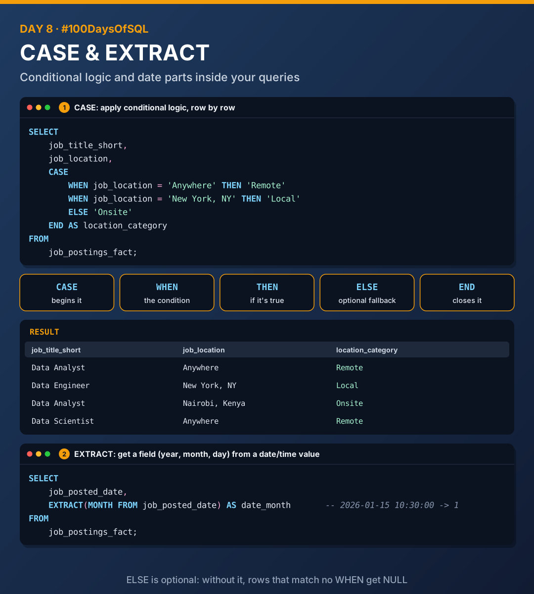
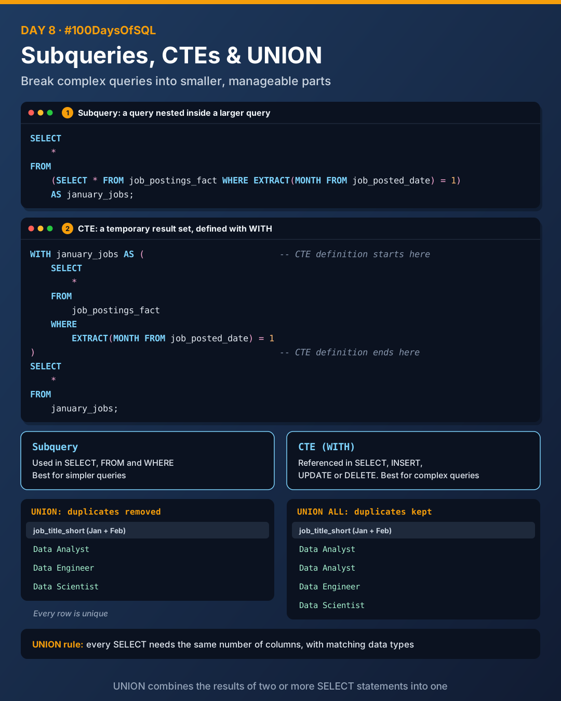

# Day 8: EXTRACT, CASE, Subqueries, CTEs and UNION

Today I learnt how to pull parts out of dates, add if/then logic to queries, break big queries into smaller pieces, and stack results from different queries together.



## EXTRACT

`EXTRACT` gets a field (e.g. year, month, day) from a date/time value.

```sql
SELECT
    EXTRACT(MONTH FROM job_posted_date) AS date_month
FROM
    job_postings_fact;
```

## CASE expressions

A `CASE` expression is a way to apply conditional logic within your SQL queries.

```sql
SELECT
    job_title_short,
    job_location,
    CASE
        WHEN job_location = 'Anywhere' THEN 'Remote'
        WHEN job_location = 'New York, NY' THEN 'Local'
        ELSE 'Onsite'
    END AS location_category
FROM
    job_postings_fact;
```

| Keyword | Role |
|---------|------|
| `CASE` | Begins the expression |
| `WHEN` | Specifies the condition to look at |
| `THEN` | What to do when the condition is true |
| `ELSE` | (Optional) output if none of the `WHEN` conditions are met |
| `END` | Concludes the `CASE` expression |

| job_title_short | job_location | location_category |
|-----------------|--------------|-------------------|
| Data Analyst | Anywhere | Remote |
| Data Engineer | New York, NY | Local |
| Data Analyst | Nairobi, Kenya | Onsite |

## Subqueries and CTEs



Subqueries and Common Table Expressions (CTEs) are used for organising and simplifying complex queries. They help break a query down into smaller, more manageable parts.

**Which one to use?**

- Subqueries are for simpler queries
- CTEs are for more complex queries

### Subqueries

A subquery is a query nested inside a larger query. It can be used in the `SELECT`, `FROM` and `WHERE` clauses.

```sql
SELECT
    *
FROM
    (SELECT * FROM job_postings_fact WHERE EXTRACT(MONTH FROM job_posted_date) = 1)
    AS january_jobs;
```

### CTEs

A CTE defines a temporary result set that you can reference.

- It's defined with `WITH`
- It can be referenced within a `SELECT`, `INSERT`, `UPDATE` or `DELETE` statement

```sql
WITH january_jobs AS (     -- CTE definition starts here
    SELECT
        *
    FROM
        job_postings_fact
    WHERE
        EXTRACT(MONTH FROM job_posted_date) = 1
)                          -- CTE definition ends here
SELECT
    *
FROM
    january_jobs;
```

## UNION operators

UNION operators combine the result sets of two or more `SELECT` statements into a single result set.

| Operator | Duplicates |
|----------|------------|
| `UNION` | Removed: all rows are unique |
| `UNION ALL` | Kept: includes all duplicate rows |

```sql
SELECT
    column_name
FROM
    table_one

UNION      -- combine the two tables

SELECT
    column_name
FROM
    table_two;
```

> **Rule:** each `SELECT` in the `UNION` must have the same number of columns, and the data types must match. Otherwise PostgreSQL returns errors like *each UNION query must have the same number of columns*.

## Files

All files were tested in PostgreSQL 16.

| File | What it covers |
|------|----------------|
| [`01_extract.sql`](./01_extract.sql) | Year, month and day from a timestamp |
| [`02_case.sql`](./02_case.sql) | CASE, WHEN, THEN, ELSE, END |
| [`03_subqueries_ctes.sql`](./03_subqueries_ctes.sql) | The same January filter as a subquery and as a CTE |
| [`04_union.sql`](./04_union.sql) | UNION vs UNION ALL, and the matching-columns rule |

## Key takeaways

- `EXTRACT` pulls one part out of a date.
- `CASE` is SQL's if/then/else.
- Subqueries for simple jobs, CTEs (`WITH`) for complex ones.
- `UNION` removes duplicates, `UNION ALL` keeps them, and both need matching columns.

---

[Back to all days](../README.md)
