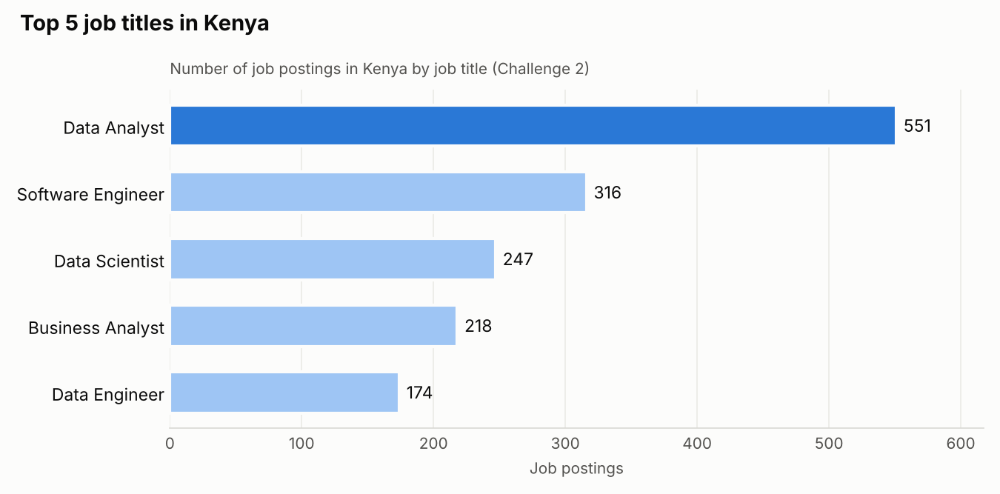
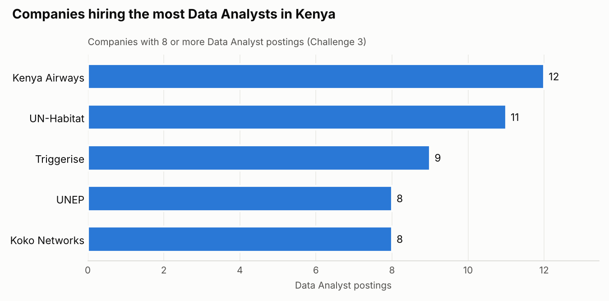

# Day 9: Practice Challenges on the Kenyan Job Market

Days 1 to 8 were about learning new SQL topics. Today I switched to practice: three challenges on real job postings data, from easy to hard, all focused on the Kenyan job market.

The data is the same job postings database from my [SQL job market project](https://github.com/CosmasMwirigi/SQL_Project_Data_Job_Analysis): 787,686 data job postings from 2023, running in PostgreSQL.

## Challenge 1 (Easy): Data Analyst jobs in Kenya

**Question:** How many Data Analyst job postings are there in Kenya?

Before filtering, I checked how Kenya is spelled in the `job_country` column with a quick `LIKE` search. Once I knew the exact value, I switched to `=` so the filter matches Kenya and nothing else.

```sql
SELECT
    COUNT(job_id) AS kenya_data_analyst_jobs
FROM
    job_postings_fact
WHERE
    job_country = 'Kenya' AND
    job_title_short = 'Data Analyst';
```

| kenya_data_analyst_jobs |
|-------------------------|
| 551 |

There are 1,715 job postings in Kenya in total, so **Data Analyst roles make up about 32% of them**.

## Challenge 2 (Medium): Top 5 job titles in Kenya

**Question:** Which 5 job titles have the most postings in Kenya?



```sql
SELECT
    job_title_short,
    COUNT(job_id) AS job_count
FROM
    job_postings_fact
WHERE
    job_country = 'Kenya'
GROUP BY
    job_title_short
ORDER BY
    job_count DESC
LIMIT
    5;
```

| job_title_short | job_count |
|-----------------|-----------|
| Data Analyst | 551 |
| Software Engineer | 316 |
| Data Scientist | 247 |
| Business Analyst | 218 |
| Data Engineer | 174 |

**Takeaway:** Data Analyst is the most posted role in Kenya by a wide margin, with almost 75% more postings than Software Engineer in second place.

## Challenge 3 (Hard): Companies hiring the most Data Analysts in Kenya

**Question:** Which companies post the most Data Analyst jobs in Kenya? Leave out placeholder names, and only show companies with 8 or more postings.



```sql
SELECT
    company_dim.name AS company_name,
    COUNT(job_postings_fact.job_id) AS job_count
FROM
    job_postings_fact
LEFT JOIN company_dim
    ON job_postings_fact.company_id = company_dim.company_id
WHERE
    job_postings_fact.job_country = 'Kenya' AND
    job_postings_fact.job_title_short = 'Data Analyst' AND
    company_dim.name NOT IN ('confidential', 'Anonymous Employer')
GROUP BY
    company_dim.name
HAVING
    COUNT(job_postings_fact.job_id) >= 8
ORDER BY
    job_count DESC;
```

| company_name | job_count |
|--------------|-----------|
| Kenya Airways | 12 |
| UN-Habitat | 11 |
| Triggerise | 9 |
| United Nations Environment Programme (UNEP) | 8 |
| Koko Networks | 8 |

**How each part works:**

| Clause | What it does here |
|--------|-------------------|
| `LEFT JOIN company_dim` | Brings in the company name for each job |
| `WHERE ... NOT IN (...)` | Keeps Kenyan Data Analyst jobs and removes the placeholder names |
| `GROUP BY` | Makes one group per company |
| `HAVING COUNT(...) >= 8` | Keeps only companies with 8 or more postings (`WHERE` can't filter on a count) |
| `ORDER BY job_count DESC` | Puts the biggest hirers first |

**Takeaway:** the biggest hirers are a mix of an airline, UN agencies and tech startups. The top 5 hold only 48 of the 551 postings, so Data Analyst hiring in Kenya is spread across many employers.

## What I noticed in the data

- **Placeholder names:** the companies with the most postings were actually "confidential" (18) and "Anonymous Employer" (12). They aren't real company names, which is why the challenge removes them.
- **Duplicate company names:** some companies appear under two spellings, such as "UN-Habitat" and "UN-HABITAT - United Nations Human Settlements Programme", or "Koko Networks" and "KOKO Networks". Their counts are split, so a future data cleaning challenge could merge them.

## Mistakes I made and fixed

- **Exploring vs answering:** my first attempt at Challenge 1 listed the country name instead of counting jobs. Useful for checking the spelling, but not the answer.
- **A semicolon in the wrong place:** `;` ends a statement, so putting it before `ORDER BY` breaks the query. It belongs only at the very end.
- **Sorting by the wrong column:** "most to fewest" means sorting by the count, not by the title name.

## Files

All files were tested in PostgreSQL.

| File | What it covers |
|------|----------------|
| [`01_challenges.sql`](./01_challenges.sql) | All three challenges with my solutions |

## Key takeaways

- Check what the data looks like before you filter it.
- `COUNT` + `GROUP BY` answers "how many per group".
- `ORDER BY ... DESC` + `LIMIT` answers "top N".
- `WHERE` filters rows, `HAVING` filters groups.
- `NOT IN` removes a list of values in one line.

---

[Back to all days](../README.md)
